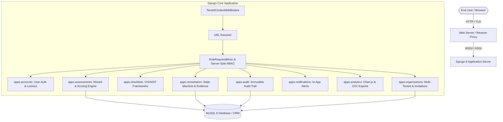
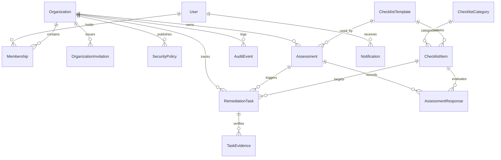

# CyberSafe — Personal & Organizational Cybersecurity Management Platform

[](https://github.com/cybersafe/cybersafe/actions)
[](https://www.djangoproject.com/)
[](https://www.mysql.com/)
[](https://sharkfest.wireshark.org/sfeu/)
[]()

**CyberSafe** is an enterprise-grade cybersecurity posture management platform designed for organizations and individuals to evaluate defense practices, benchmark controls against CIS Controls v8 and NIST CSF 2.0, prioritize remediation tasks, inspect technical evidence, and track posture metrics from a unified workspace.

---

## System Architecture



---

## Entity-Relationship Diagram (ERD)



---

## Four Primary Application Roles (RBAC)

| Role | Access Scope | Capabilities | Restrictions |
| :--- | :--- | :--- | :--- |
| **Platform Super Admin** | Platform-Wide | Create & approve organizations; publish global frameworks; inspect system audit logs; monitor platform health. | Audited access only; cannot alter private organizational findings without operational cause. |
| **Organization Admin** | Single Organization | Manage workspace; invite colleagues; assign roles; initiate assessments; view org compliance KPIs; publish policies. | Cannot view other organizations' records; cannot escalate own role to Super Admin. |
| **Security Analyst** | Authorized Organization | Review submitted assessments; evaluate evidence; verify or return remediation tasks; analyze risk trends. | Cannot modify global frameworks; cannot access unassigned organizations. |
| **Employee / Member** | Assigned Scope | Complete assigned questionnaires; submit draft responses; review personal tasks; submit resolution notes & evidence. | Cannot self-verify tasks; cannot view peer evaluations without explicit permission. |

---

## Visual Theme: Inspired by SharkFest Europe

CyberSafe incorporates the technical conference visual hierarchy inspired by [SharkFest Europe](https://sharkfest.wireshark.org/sfeu/):
- **Deep Midnight Navy Background** (`#050b14`, `#081220`) with subtle SVG packet-grid coordinates.
- **Oceanic Blue Accents** (`#0066cc`, `#0080ff`) for structured controls and primary actions.
- **Electric Cyan Highlights** (`#00f0ff`, `#38bdf8`) for high-contrast emphasis, focus rings, and metrics.
- **Shark-Fin Geometric Accents** integrated into cards and brand iconography.
- **Chart.js Visualizations**: Dark-theme Radar charts, Doughnut posture gauges, and Domain bar charts.

---

## Quickstart & Installation

### Prerequisites
- Python 3.12+ (or Python 3.14)
- MySQL 8.0 (Optional — SQLite fallback active by default for instant local setup)

### 1. Clone & Setup Virtual Environment
```powershell
git clone https://github.com/cybersafe/cybersafe.git
cd cybersafe
python -m venv venv
.\venv\Scripts\Activate.ps1
pip install -r requirements.txt
```

### 2. Configure Environment (`.env`)
```powershell
cp .env.example .env
```
*(By default, `DB_ENGINE=sqlite3` is set for zero-setup execution. For MySQL 8, set `DB_ENGINE=mysql` and update `DB_NAME`, `DB_USER`, `DB_PASSWORD`)*.

### 3. Run Migrations & Seed Demo Data
```powershell
python manage.py migrate
python manage.py seed_cyber_data
```

### 4. Start the Application
```powershell
python manage.py runserver
```
Visit `http://localhost:8000/` in your browser.

---

## Seed Demo Credentials

| Role | Email | Password | Organization |
| :--- | :--- | :--- | :--- |
| **Super Admin** | `superadmin@cybersafe.local` | `AdminPass123!` | Global Platform |
| **Org Admin** | `admin@apexfin.com` | `ApexAdminPass123!` | Apex Financial Group |
| **Security Analyst** | `analyst@apexfin.com` | `AnalystPass123!` | Apex Financial Group |
| **Employee** | `alice@apexfin.com` | `EmployeePass123!` | Apex Financial Group |

---

## Automated Test Execution

Run the complete test suite:
```powershell
python manage.py test tests
```

---

## Important Product Limitation Notice

> [!WARNING]
> **CyberSafe is a cybersecurity posture management and assessment platform.** It does not scan user hardware devices, intercept live network packets, detect zero-day malware, or certify an organization as immune to cyberattacks.
>
> All assessments and compliance scores reflect **self-attested questionnaire responses, submitted documentation, and authorized evidence reviews**. A 100% checklist score indicates adherence to documented policies, not an absolute guarantee of technical security.
